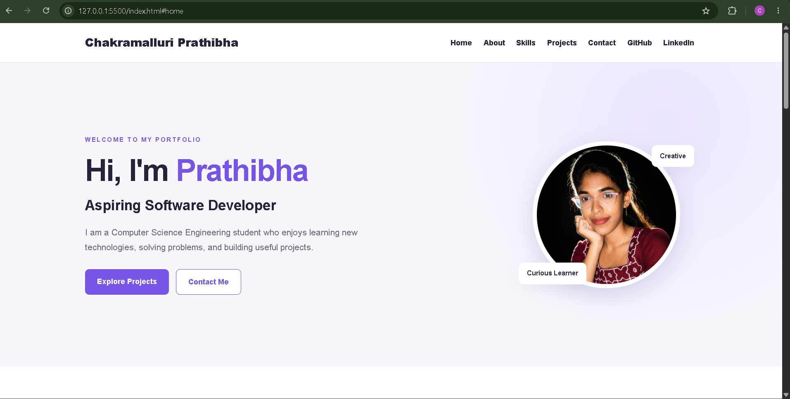
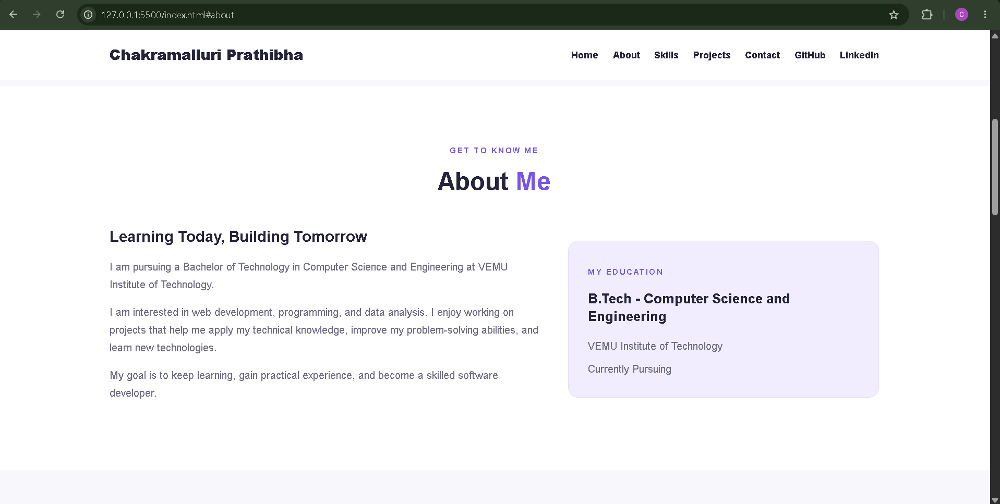
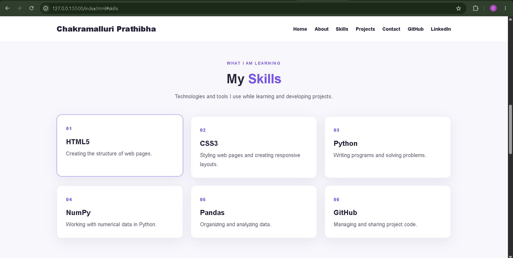
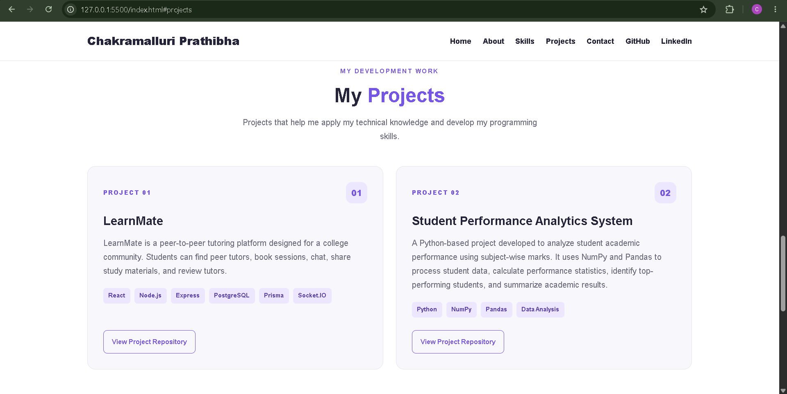
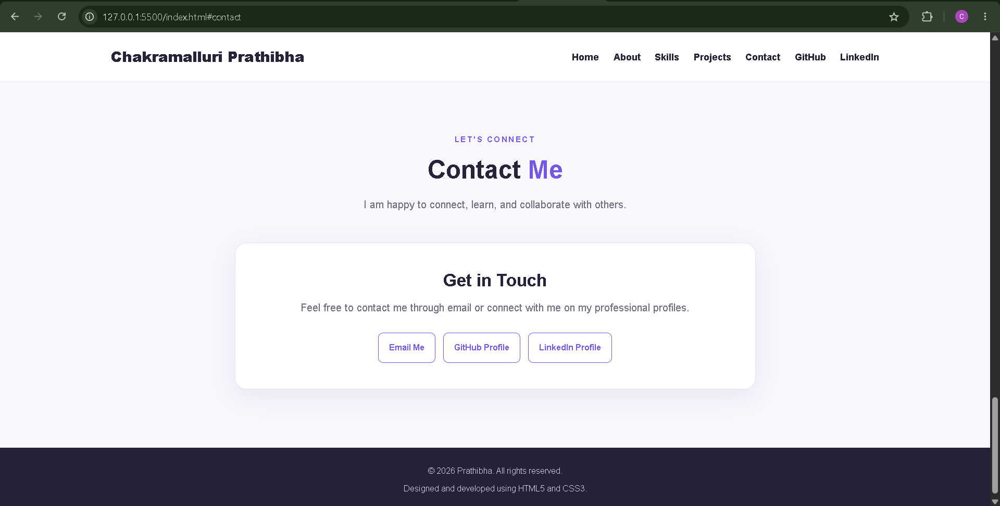

# Personal Portfolio Website

## About the Project

The Personal Portfolio Website is a beginner-friendly web development project built using HTML5 and CSS3. It presents my personal introduction, educational background, technical skills, academic projects, and contact information in a clean and user-friendly layout.

## Objectives

- To build a personal portfolio website using HTML5 and CSS3.
- To showcase my education, technical skills, and projects.
- To practice front-end web development.
- To provide easy access to my professional profiles and contact details.

## Technologies Used

- HTML5
- CSS3
- Visual Studio Code
- Git and GitHub
- GitHub Pages

## Features

- Home section with personal introduction
- About section with educational details
- Skills section
- Projects section with GitHub repository links
- Contact section with email, GitHub, and LinkedIn links
- Personal profile photo
- Responsive layout for different screen sizes

## Projects

### 1. LearnMate

A student learning platform focused on sharing learning resources, skills, and knowledge.

**GitHub Repository:** https://github.com/chakramalluriprathibha/LearnMate

### 2. Student Performance Analytics System

A Python project that uses NumPy and Pandas to analyze student marks and academic performance.

**GitHub Repository:** https://github.com/chakramalluriprathibha/Student-Performance-Analytics-System

## Project Structure

```text
Personal-Portfolio-Website/
├── index.html
├── style.css
├── my-photo.jpg
├── README.md
└── screenshots/
    ├── home.png
    ├── about.png
    ├── skills.png
    ├── projects.png
    └── contact.png
```

## Screenshots

### Home


### About


### Skills


### Projects


### Contact


## How to Run Locally

1. Clone or download this repository.
2. Open the project folder in Visual Studio Code.
3. Open `index.html` in a browser or use the Live Server extension.
4. Navigate through the five sections.

## Live Website

Visit my deployed portfolio:

https://chakramalluriprathibha.github.io/Personal-Portfolio-Website/

## Author

**Chakramalluri Prathibha**

- **GitHub:** https://github.com/chakramalluriprathibha
- **LinkedIn:** https://www.linkedin.com/in/chakramalluri-prathibha-61a1b63b9/
- **Email:** prathibhanavyasree169@gmail.com

## Future Enhancements

- Add a downloadable resume.
- Improve accessibility and responsive design.
- Add interactive features using JavaScript.
- Showcase additional projects.

## Conclusion

This project demonstrates the use of HTML5 and CSS3 to create a personal portfolio website. It provides an organized way to present my profile, education, technical skills, and academic projects for academic and internship purposes.